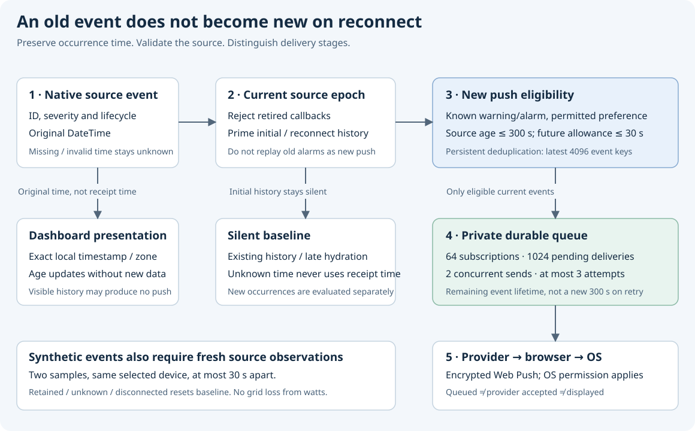

# Inverter Dashboard Go

[](https://www.bestpractices.dev/projects/15568)

[](docs/fuzzing.md)

[English](README.md) · [Русский](README.ru.md) · [Українська](README.uk.md) · [Deutsch](README.de.md) · [Français](README.fr.md) · [Nederlands](README.nl.md)

A Go server for a Victron installation, with the shared Vue dashboard embedded in its executable. It reads native Cerbo MQTT telemetry or an HTTPS inverter-gateway (IGW), adds optional Home Assistant data, and exposes controls only when their source and capabilities permit them.

This is a Go application: Node.js and npm are not required to run it. The browser UI is maintained in [inverter-dashboard-vue](https://github.com/victron-venus/inverter-dashboard-vue); the Python server is [inverter-dashboard](https://github.com/victron-venus/inverter-dashboard).


The illustrated [process and results guide](docs/process-and-results.md) explains the update stages, the HA polling-duration regression and the Home mapping contract. It separates source-test results from official release, deployment and browser acceptance.

## What it provides

- Live grid, battery, PV, consumption, water and EV information, subject to the native services and instances installed on your system.
- Controller-provided daily statistics, grid energy coverage, forecasts and tariff information. Missing readings remain unknown; the dashboard does not create historical coverage that the source did not supply.
- Capability-gated ESS selection, controller switches, water modes, persistent setpoint override and tariff editing. Source changes and stale observations invalidate command permission.
- Optional Home Assistant switches, active appliances, covers, media players, scenes, number controls, sensors and weather. Home buttons come from your configuration, including labels, order and enabled state.
- Native warning/alarm lifecycle and original occurrence times, with exact local timestamps and relative ages in the shared UI.
- Opt-in encrypted Web Push, including delivery while tabs are closed on supported browsers. Delivery still depends on the browser, provider, network and OS notification settings.
- Persistent dashboard settings, authenticated HTTP/WebSocket access, `/health` and Prometheus `/metrics`.

Feature availability is not a promise that every Desktop function or every firmware supports every control. See [operation and safety](docs/operations.md) for the boundaries.

## Install and start

For a packaged installation, choose an explicit version and platform from [Releases](https://github.com/victron-venus/inverter-dashboard-go/releases), verify its published checksums and provenance, and follow the release notes. Beta/nightly/RC artifacts are previews. The committed base version is in [VERSION](VERSION); a package can have a longer candidate version.

To build from source, use the Go toolchain required by [go.mod](go.mod) (currently Go 1.26.9):

```sh
git clone https://github.com/victron-venus/inverter-dashboard-go.git
cd inverter-dashboard-go
go mod download
go build -trimpath -ldflags "-X main.Version=$(cat VERSION)" -o inverter-dashboard .
./inverter-dashboard --version
cp config.yaml.example config.yaml
chmod 600 config.yaml
```

**Edit `config.yaml` before starting.** Set your MQTT host and portal ID, or configure IGW. The example binds the web server to loopback and contains deliberately non-working example domains. Configure `DASHBOARD_SECRET` through your service's private environment before exposing the server. Then start from the directory containing your configuration:

```sh
./inverter-dashboard
```

The server reads `config.yaml` from its **working directory**. There is no `--config` flag. The example serves HTTP on `127.0.0.1:8080`; use a trusted HTTPS reverse proxy for remote access and Web Push. Native TLS is available with both `--ssl-cert` and `--ssl-key`.

For containers, read [the container and persistence instructions](docs/operations.md#containers-and-persistence). The image works in `/app`, so the configuration file belongs at `/app/config.yaml` unless you explicitly change its working directory. A directory mounted only at `/app/config` is not automatically read.

## Configure your installation

Start with [config.yaml.example](config.yaml.example) and the [configuration reference](docs/configuration.md).

- **MQTT:** set `mqtt.host` and `cerbo.portal_id`. An explicit portal bootstraps a quiet broker; passive discovery needs incoming native traffic. Native keepalive and configured water-mode refresh run every 20 seconds.
- **IGW:** configure an HTTPS URL and credentials. An empty YAML `mqtt.host` with IGW enabled selects gateway-only operation. With both configured, MQTT is preferred and IGW provides failover; recovery probes run approximately every 60 seconds.
- **Home Assistant:** configure its URL, token and a `switch_entities` mapping keyed by stable names. An empty mapping (`{}`) means no Home buttons. There is no personal entity list to copy from this repository. Preserve your existing inventory when upgrading; do not replace it with the example.
- **Settings:** set `INVERTER_DASHBOARD_SETTINGS_FILE` to a writable persistent path, for example `/var/lib/inverter-dashboard/settings/dashboard_settings.json`. The default is `dashboard_settings.json` in the working directory. Connection changes require a restart; visibility settings apply to subsequent state updates.
- **Web Push:** set `WEB_PUSH_ENABLED=true` and an absolute, private, persistent `WEB_PUSH_DATA_DIR`. Then opt in from a supported browser over HTTPS. See [notifications](docs/web-push.md) before choosing storage or enabling replicas.

Precedence is field-specific, not a universal “environment always wins” rule. YAML overrides ordinary MQTT/web defaults; explicitly set `GATEWAY_*` variables override gateway YAML; CLI overrides follow; saved MQTT/HA connection settings are applied last. See the [full explanation](docs/configuration.md#configuration-precedence).

## Controls and trust

Set `DASHBOARD_SECRET` and keep the service on a trusted network. Without that variable the application does not authenticate dashboard access. There is no separate read-only user role. `/health`, `/metrics` and designated static resources are public at the application layer; restrict them at your ingress as appropriate.

The backend checks configured targets, current source ownership and fresh observations before dispatch. Retained telemetry can be displayed but does not grant fresh command permission. A queued or accepted request is not proof of physical completion: check authoritative telemetry and the device's state.

**DRY is not a global safety lock.** Persistent setpoint override set/clear follows the controller's documented semantics and is independent of DRY. Browser read-only presentation is not a replacement for network access controls or safe device procedures.

Do not test a deployment by toggling equipment, acknowledging alarms or changing inverter modes. Begin with the read-only checks in [troubleshooting](docs/troubleshooting.md). Report vulnerabilities through [SECURITY.md](SECURITY.md).

## Notifications and event time



A replayed warning retains its original source timestamp. An absent or invalid timestamp stays unknown rather than becoming “just now.” Browser age labels refresh without another MQTT message and after foregrounding. Alarm resolution, acknowledgement, silence and local presentation are different operations; do not infer device acknowledgement from a hidden banner.

Web Push uses startup/reconnect priming, persistent deduplication and bounded delivery. Its limits include 64 subscriptions, 1024 pending deliveries, two concurrent sends and at most three attempts. A test API `202` means queued, and a provider `2xx` means accepted by the provider; neither proves OS display. [Web Push details and limitations](docs/web-push.md).

## UI versions and languages

The embedded UI is the official **Vue v2.2.8** artifact (package `2.2.8`, source `ff3865d373cc3819b83db0328d9855a2bdec9859`). [Its receipt](internal/html/vue-ui-source.json) records the exact artifact provenance and file hashes. The files are byte-identical to the accepted RC `v2.2.8-rc.1` (build run `38861405495`).

These six READMEs document the Go application. Translations added to the separate Vue source do **not** appear in an existing Go binary until an official frontend artifact is reviewed and embedded. Do not infer complete UI translation support from the documentation languages or bundled date-library locale files.

## Help and development

- [Configuration](docs/configuration.md) · [Operation, controls and storage](docs/operations.md)
- [Troubleshooting](docs/troubleshooting.md) · [Web Push](docs/web-push.md)
- [Developer guide](docs/development.md) · [Contribution policy](CONTRIBUTING.md) · [Verification checklist](README-CHECKLIST.md)
- [Repository wiki source](docs/wiki/Home.md) · [Legacy npm wrapper notes](README-NPM.md)
- [RC-only fuzzing](docs/fuzzing.md) · [Changelog](CHANGELOG.md) · [License](LICENSE)


<!-- ci-release-process:start -->
## Release process

See the [release strategy](RELEASING.md) for validation, nightly, beta, RC and stable promotion rules, and the [operator runbook](docs/release-workflow.md) for local commands.
<!-- ci-release-process:end -->

## Browser compatibility

The [embedded frontend acceptance suite](docs/browser-compatibility.md) verifies the shipped SPA in real browser engines across Linux, Windows and macOS. Its required matrix is part of the existing CI gate, with expanded version coverage for scheduled and manual release qualification.
