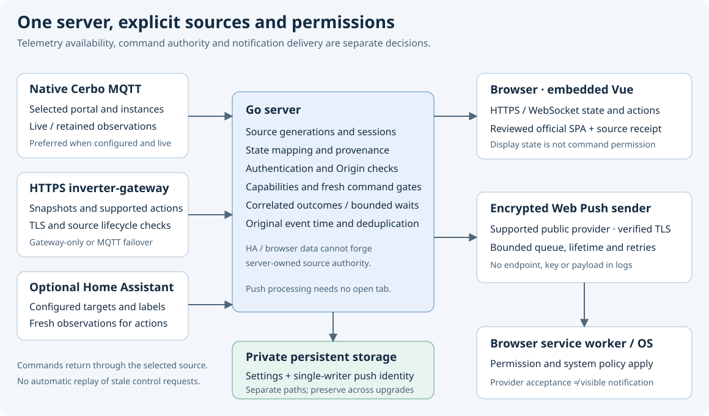

# Inverter Dashboard Go

[English](README.md) · [Русский](README.ru.md) · [Українська](README.uk.md) · [Deutsch](README.de.md) · [Français](README.fr.md) · [Nederlands](README.nl.md)

Вебпанель для установки Victron: сервер Go із вбудованим інтерфейсом Vue. Телеметрія надходить від Cerbo через MQTT або HTTPS inverter-gateway (IGW). Home Assistant підключається окремо для домашніх пристроїв і датчиків. Для запуску готового виконуваного файла Node.js та npm не потрібні.



## Можливості

- Мережа, акумулятори, сонячна генерація, споживання, вода й електромобіль — за наявності відповідних служб і даних.
- Добова статистика, інтервали обліку енергії, прогноз і тарифи від контролера. Відсутні дані не перетворюються на нулі чи повну історію.
- Вибір ESS, перемикачі контролера, режими води, постійне перевизначення уставки та редагування тарифів за підтримуваних можливостей і свіжих даних.
- Налаштовувані кнопки Home, активні побутові прилади, штори, медіаплеєри, сцени, числові параметри, датчики й погода Home Assistant.
- Нативні попередження з початковим часом події, а також зашифровані системні сповіщення Web Push за згодою користувача.
- Збереження налаштувань, HTTP/WebSocket API, `/health` і метрики `/metrics`.

Це не гарантія повної відповідності Desktop або підтримки будь-якого обладнання. Доступність залежить від джерела, прошивки, конфігурації та свіжості спостережень.

## Встановлення та запуск

Виберіть конкретну версію й платформу в [Releases](https://github.com/victron-venus/inverter-dashboard-go/releases), перевірте опубліковані контрольні суми та походження файлів. Beta/nightly/RC — попередні версії. Базову версію містить [VERSION](VERSION).

Для збирання потрібен Go, зазначений у [go.mod](go.mod), наразі 1.26.9:

```sh
git clone https://github.com/victron-venus/inverter-dashboard-go.git
cd inverter-dashboard-go
go mod download
go build -trimpath -ldflags "-X main.Version=$(cat VERSION)" -o inverter-dashboard .
./inverter-dashboard --version
cp config.yaml.example config.yaml
chmod 600 config.yaml
```

**Перед запуском відредагуйте `config.yaml`.** Приклади доменів навмисно не працюють. Укажіть власне джерело й portal ID, задайте `DASHBOARD_SECRET` через приватне середовище служби. Після цього запускайте `./inverter-dashboard` з каталогу конфігурації. Файл читається з робочого каталогу; параметра `--config` немає.

Приклад слухає `127.0.0.1:8080`. Для віддаленого доступу та Web Push потрібен довірений HTTPS-проксі; вбудований TLS вмикається парою `--ssl-cert` і `--ssl-key`. Контейнер працює в `/app`, тому типовий шлях конфігурації — `/app/config.yaml`, а не лише підкаталог `/app/config`.

## Конфігурація та збереження

Дивіться [повний довідник](docs/configuration.md). Для MQTT задайте `mqtt.host` і `cerbo.portal_id`. Явний portal ID дозволяє почати читання навіть від тихого брокера. Для IGW потрібні HTTPS URL та відповідні облікові дані. Порожній YAML `mqtt.host` з увімкненим шлюзом обирає лише IGW. Якщо налаштовано обидва джерела, перевагу має MQTT; у разі недоступності використовується шлюз, а відновлення MQTT періодично перевіряється.

Пріоритет залежить від поля: YAML перекриває звичайні значення MQTT/web; явно задані `GATEWAY_*` перекривають YAML шлюзу; далі застосовуються CLI-параметри та збережені налаштування з’єднань MQTT/HA. Зміни з’єднання потребують перезапуску.

Кнопки Home беруться з вашого `homeassistant.switch_entities`. Явний список зберігає підписи, порядок і `enabled`. Порожній список означає відсутність кнопок; невідомий стан не вважається вимкненим. Під час оновлення зберігайте власні пристрої й токени, не замінюйте їх прикладами. Побутовий прилад показується активним лише за ввімкненої видимості та відповідного стану роботи.

Для постійних налаштувань задайте `INVERTER_DASHBOARD_SETTINGS_FILE`, наприклад `/var/lib/inverter-dashboard/settings/dashboard_settings.json`. Типово використовується `dashboard_settings.json` у робочому каталозі. Файл може містити токен HA, хоча API його приховує. Потрібен приватний постійний том із правом запису: read-only Secret або тимчасовий каталог не підходить. Зміни видимості застосовуються без перезапуску.

## Безпека керування

Без `DASHBOARD_SECRET` вбудована автентифікація вимкнена. Окремих ролей «лише перегляд» немає. Для API віддавайте перевагу Bearer-заголовку: токени в URL можуть потрапити в історію чи журнали. `/health`, `/metrics` і визначені статичні ресурси публічні на рівні застосунку; за потреби обмежте їх на проксі.

Перед надсиланням сервер перевіряє дозволену ціль, поточне джерело та свіжість даних. Retained-повідомлення можуть заповнювати екран, але не дають нового дозволу на керування. Прийняття запиту не доводить фізичного виконання — перевіряйте авторитетний стан пристрою.

**DRY не є загальним блокуванням.** Установлення та скасування постійного перевизначення уставки працюють незалежно від DRY за протоколом контролера. Не перевіряйте встановлення перемиканням обладнання або підтвердженням справжньої тривоги. Деталі: [експлуатація](docs/operations.md), [безпека](SECURITY.md).

## Події та Web Push

Повторно отримане попередження зберігає початковий час; відсутній чи некоректний час залишається невідомим. Інтерфейс оновлює відносний вік без нових повідомлень і після повернення до вкладки, показує точний місцевий час із часовим поясом. Зникнення, підтвердження та приглушення тривоги — різні дії.

Для Web Push потрібні HTTPS, підтримуваний браузер, дозвіл ОС та `WEB_PUSH_ENABLED=true` з абсолютним `WEB_PUSH_DATA_DIR` на постійному томі. Серверне приватне сховище підтримується на Linux/macOS; на Windows ця функція недоступна. Використовуйте один процес на сховище, зберігайте ключі й підписки під час оновлень і не видаляйте їх для «виправлення» доставки.

Історія під час запуску чи повторного з’єднання не розсилається заново. Межі: 64 підписки, 1024 доставки в черзі, два паралельні надсилання, до трьох спроб, строк події до п’яти хвилин. API `202` означає чергу, відповідь провайдера `2xx` — прийняття провайдером, а не показ ОС. [Докладніше](docs/web-push.md).

## Діагностика, інтерфейс і розробка

Якщо сторінка не відкривається, перевірте адресу прослуховування, DNS/VPN-маршрут, TLS та автентифікацію. Якщо Home недоступний, перевірте справжнє читання сутностей HA та свіжість даних, а не лише значок з’єднання. Якщо налаштування зникають — шлях, права та постійність тому. Почніть із [перевірок без керування обладнанням](docs/troubleshooting.md); не публікуйте токени, endpoints Push або приватний конфіг.

Вбудовано офіційний Vue **v2.2.7-beta.9**, вихідний код `3d4a03fd3401334ac9e69f6d103caff41dc243ae`; [receipt](internal/html/vue-ui-source.json) містить походження та хеші. Переклади окремого Vue-репозиторію потраплять у Go лише після прийняття нового офіційного артефакту. Мова README не доводить наявності перекладу у вбудованому інтерфейсі.

Для розробки використовуйте [посібник](docs/development.md), [CONTRIBUTING](CONTRIBUTING.md) і `bash scripts/ci.sh`. UI розробляється в [inverter-dashboard-vue](https://github.com/victron-venus/inverter-dashboard-vue); не редагуйте вбудовані згенеровані файли. [Wiki](docs/wiki/Home.md) · [контрольний список](README-CHECKLIST.md) · [правила релізу](RELEASING.md) · [ліцензія](LICENSE).
