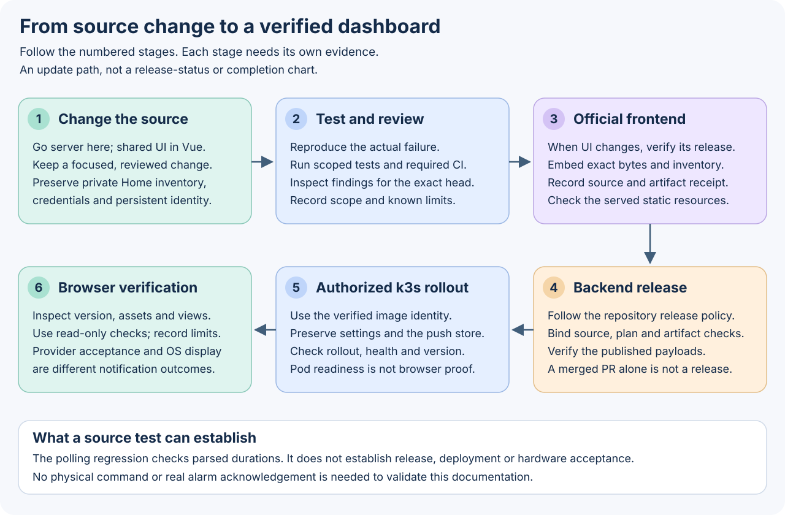
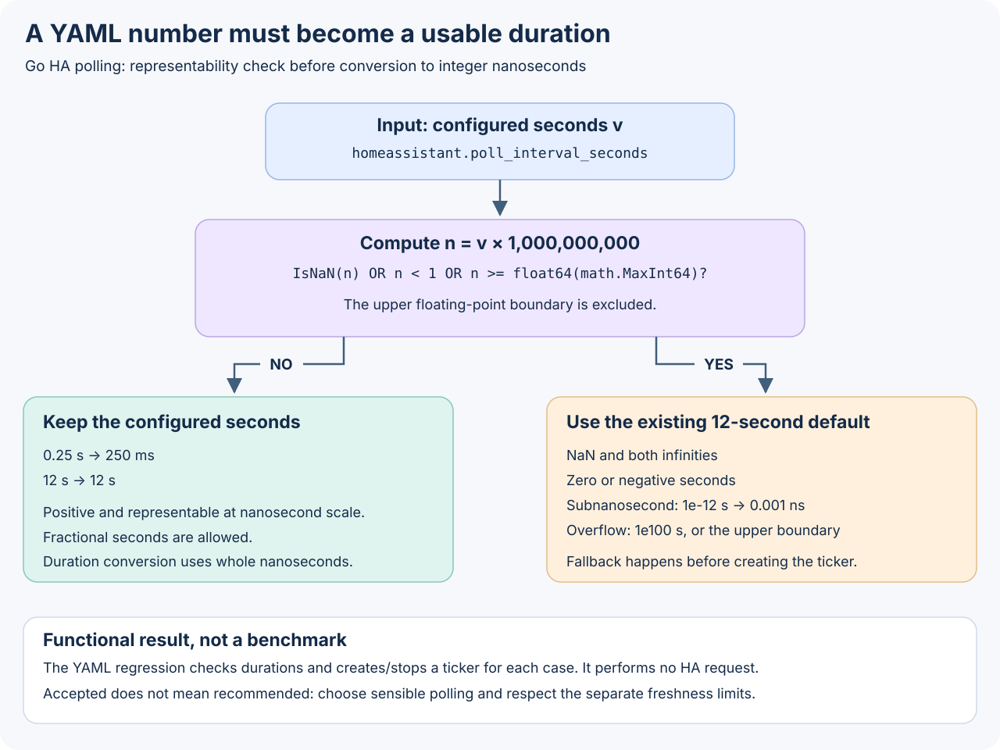

# From a source change to a verified dashboard

[README](../README.md) · [Developer guide](development.md) · [Verification checklist](../README-CHECKLIST.md) · [Wiki summary](wiki/Process-and-results.md)

The Go server, the shared Vue interface and a running installation are different things to verify. A source test can prove how a configuration value is handled; it cannot prove that a particular binary was released, deployed or displayed correctly in a browser. This guide explains the update process and the concrete configuration result documented in the October 15, 2026 source review.

## The update process



1. **Change the owning source.** Go configuration and server behavior belong here; Vue components and language catalogs belong in [inverter-dashboard-vue](https://github.com/victron-venus/inverter-dashboard-vue). Keep changes on a focused branch. Preserve the installation's private entity inventory, credentials, settings and Web Push identity.
2. **Reproduce, test and review.** Add a regression for the actual failure, run the affected package checks and applicable hooks, then inspect the required CI results and review findings for the exact proposed commit. Review documentation links and accessible SVGs too. [The developer guide](development.md#checks) describes the checks; [the checklist](../README-CHECKLIST.md) records what must be verified.
3. **Adopt an official frontend when UI changes.** First verify the published Vue artifact and its source identity. Copy its exact file inventory and bytes, then update [the embedded UI receipt](../internal/html/vue-ui-source.json). Existing HTTP and embedding tests check the served resources. A local build is not an official artifact, and new Vue translations do not appear in an older Go binary automatically. A backend-only change can retain its existing reviewed frontend.
4. **Release the backend through its policy.** Follow [RELEASING.md](../RELEASING.md) and [the operator runbook](release-workflow.md). A saved release plan, source commit, required checks and published artifact evidence establish a release. A merged PR alone does not.
5. **Deploy to k3s only when authorized.** Bind the selected image to verified release evidence, preserve persistent settings and the single-writer push store, then check rollout and health. [Operation and storage](operations.md#containers-and-persistence) covers the runtime boundaries. A healthy Pod alone does not establish the correctness of the page or its source data.
6. **Verify the browser and reported behavior.** Check the expected version, served assets, connection state and representative read-only views. Record the browser, origin, source and limitations. Notification provider acceptance is separate from actual OS display. Do not toggle equipment or acknowledge live alarms as a documentation or deployment smoke test.

The arrows show the required order of evidence, not a claim that this documentation update has completed a release or rollout. No release, k3s deployment, hardware action or OS notification result is established by the source checks below.

## A concrete result: valid HA polling durations

The configuration review found that a positive-looking number is not necessarily a usable Go ticker duration. YAML permits special floating-point values, and seconds must be converted to integer nanoseconds before the HA polling loop can use them.



The implementation is [`pollOrDefault` in config.go](../internal/config/config.go). The source reviewed for this guide is `87cb23de2e1786dd36c248a7568038697cfc68de`. For a parsed `homeassistant.poll_interval_seconds` value `v`, it computes `n = v * float64(time.Second)` and uses the existing **12-second default** when any of these is true:

- `n` is NaN;
- `n < 1`, covering zero, negative values, negative infinity and positive subnanosecond values;
- `n >= float64(math.MaxInt64)`, covering positive infinity, overflow and the excluded floating-point upper boundary.

Otherwise it keeps `v`. For example, `0.25` seconds becomes 250 milliseconds and `12` seconds remains 12 seconds. Conversion to `time.Duration` uses whole nanoseconds. This representability guard does not certify that every accepted interval is operationally sensible: use a polling interval appropriate for the HA server and the separate control-freshness rules in [configuration](configuration.md).

Before the fix, the local regression exposed zero-duration results for NaN/subnanosecond inputs and excessively long durations for infinity/overflow inputs. The guard now selects the documented fallback before those values reach the ticker. Malformed YAML is a separate parsing issue; this result concerns numeric values that YAML successfully parsed.

### What was checked

[`TestHAPollIntervalYAMLAlwaysCreatesUsableTicker`](../internal/config/config_test.go) loads an isolated YAML file, checks the resulting duration, and constructs/stops a ticker. It covers `0`, `-1`, `.nan`, `.inf`, `-.inf`, `1e100`, `9223372036.854776`, `1e-12`, `0.25` and `12`. The pre-fix run reproduced the failure; the corrected configuration and Home Assistant package checks passed with the race detector during the source change. These are functional checks, not timing or throughput benchmarks.

A maintainer can rerun the focused checks from an isolated development checkout:

```sh
go test -race ./internal/config ./internal/homeassistant
```

Do not start the server against private services merely to run these tests. Required full CI and release verification remain separate gates.

## A concrete documentation result: Home is your inventory

`homeassistant.switch_entities` is a **YAML mapping keyed by stable names**, not a list of hardcoded personal entity IDs. Its keys identify state fields; configured labels, `order` and `enabled` determine presentation and eligibility. Equal explicit order values preserve mapping declaration order. Disabled entries are excluded from Home display, polling and toggle permission; unknown state is not a known off state.

An empty mapping is intentional:

```yaml
homeassistant:
  switch_entities: {}
```

It creates no Home buttons. It is not a request to restore example devices. The [configuration example](../config.yaml.example) and [configuration guide](configuration.md#home-assistant-and-home-buttons) describe this contract; [`home_order_test.go`](../internal/config/home_order_test.go) covers declaration order, mapping shape and empty/alias forms. Existing private inventories must be preserved when upgrading.

The documentation now distinguishes Go build commands from historical npm wrappers, gives useful setup/security/storage guidance in six README languages, and explains source time and private persistence. These documentation changes do not alter a device's configuration and do not prove that a newer shared UI has been embedded. Consult the actual frontend receipt and release evidence for the installed build.

## Keep the evidence useful

Record the source commit, tests and their scope; for a release add the actual plan, artifact identities and verification outcome; for deployment add the image, rollout and read-only browser checks. Report failures and untested stages explicitly. Keep credentials, private Home entities and push subscription endpoints out of screenshots, logs and public reports.
